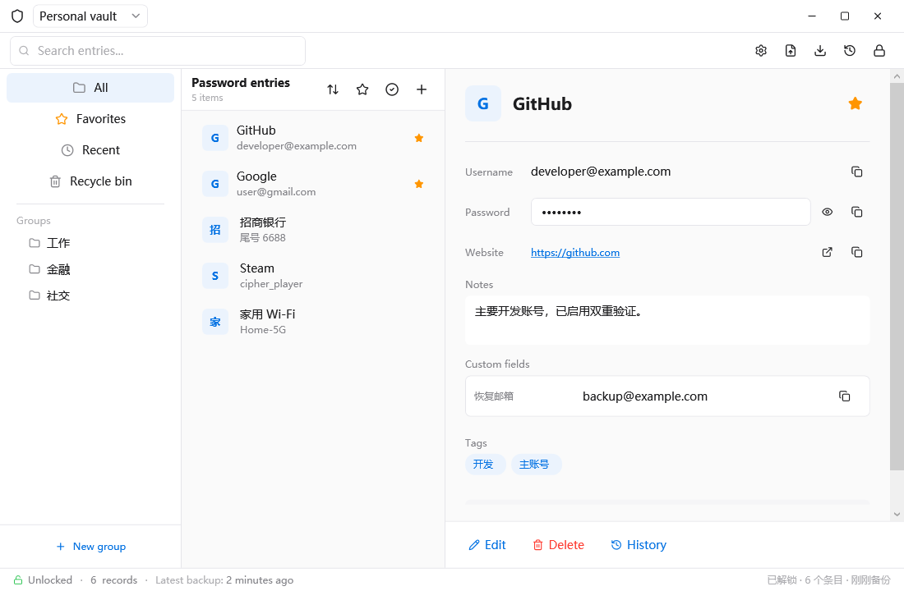
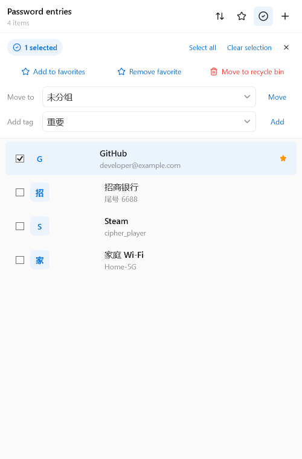
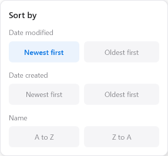

# CipherVault

[简体中文](README.md) | English

**A local password manager for Windows.** Organize your accounts in an encrypted vault, search offline, and keep backups under your control.

[Download](https://github.com/Xie-Fantasy/CipherVault/releases/latest) · [Report an issue](https://github.com/Xie-Fantasy/CipherVault/issues)

> CipherVault has not undergone an independent security audit. Keep reliable backups and assess whether it meets your security needs.

## Screenshots

English interface:



Bulk management and sorting:





Screenshots use sample data. The main window is from version 1.0.11; bulk management and sorting are from version 1.0.15. Some user-created sample labels remain in Chinese, and the current interface may differ slightly.

## Features

- **Local vaults:** unlock with a master password and keep encrypted vaults and backups on your device; recovery words support account recovery.
- **Find and organize:** search, groups, tags, favorites, sorting, bulk actions, entry history, and a recycle bin.
- **Secure access:** hidden passwords, timed clipboard clearing, automatic locking, optional Windows Hello, and optional screen capture protection.
- **Migration:** CSV import and CSV/KeePass XML export. Exports contain plaintext passwords and must be protected.
- **Personalization:** light, dark and system themes, Chinese and English, system tray, and a global search shortcut.

## Download

Download a release from [GitHub Releases](https://github.com/Xie-Fantasy/CipherVault/releases/latest):

| File | Use |
| --- | --- |
| `CipherVault-1.0.15-win-x64-portable.zip` | Extract and run `CipherVault.exe`; no separate .NET installation is required. |
| `CipherVault-Setup-1.0.15-win-x64.msi` | Install with Start menu and desktop shortcuts. |
| `SHA256SUMS.txt` | Verify the SHA-256 checksums of downloaded files. |

Requires 64-bit Windows 10 version 2004 (build 19041) or later, or Windows 11. The binaries are unsigned, so Windows may display a security warning.

## Getting started

1. Create a vault and choose where to save it.
2. Set a unique master password and store the recovery words separately and securely.
3. Add entries and use search, groups or tags to find them. Configure locking, language and appearance in Settings.
4. Keep an encrypted backup in a safe location and periodically verify that it can be restored.

The developer cannot recover your master password. Before uninstalling or changing devices, make sure your vault and backups are safely stored.

## Security and privacy

CipherVault is designed for local use without cloud sync. Vaults use AES-256-GCM encryption and Argon2id key derivation; sensitive data is still handled in memory while the vault is open. Longer, unique master passwords provide better resistance to offline guessing.

No password manager can fully protect data from malware controlling the current user session or other software monitoring the clipboard. Do not post passwords, recovery words or vault files in public issues.

## Build from source

On Windows, install the .NET 8 SDK. Visual Studio users should install the .NET desktop development workload.

```powershell
dotnet restore .\CipherVault.sln
dotnet build .\CipherVault.sln -c Release
dotnet test .\CipherVault.sln -c Release
dotnet run --project .\src\CipherVault.App\CipherVault.App.csproj
```

`build-installer.ps1` builds the portable app and MSI and requires network access to restore build dependencies.

## License

Source code is published under the [MIT License](LICENSE). Third-party dependencies and assets retain their own licenses.
