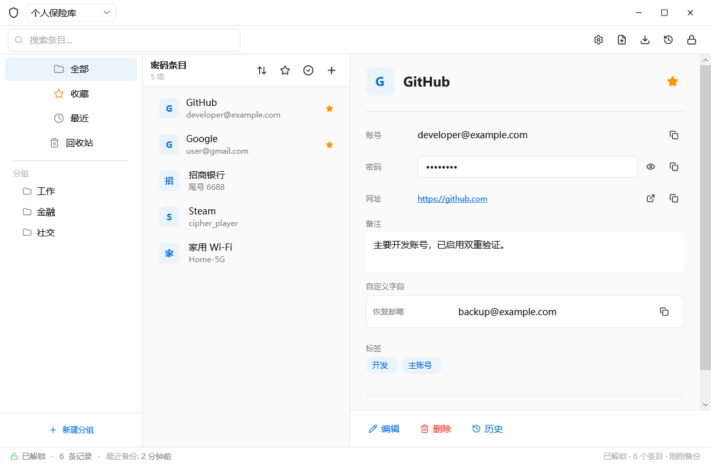
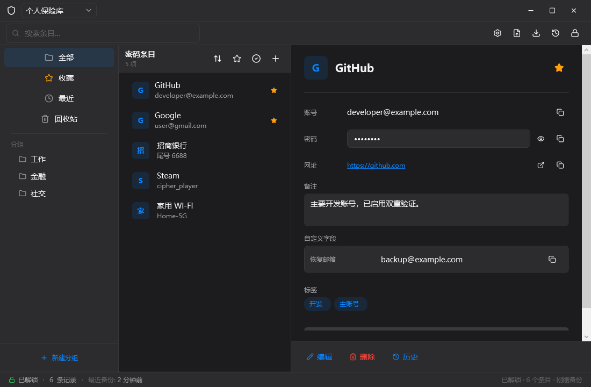
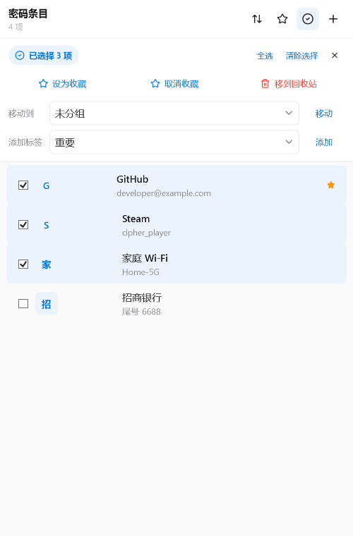

# CipherVault

**一款面向 Windows 的本地密码管理器。** 将账号、密码和备注收纳在自己的加密保险库中，离线搜索、分类和备份。

[下载最新版本](https://github.com/Xie-Fantasy/CipherVault/releases/latest) · [反馈问题](https://github.com/Xie-Fantasy/CipherVault/issues)

> 本仓库公开提供程序和使用说明，当前不包含源代码。程序尚未经过独立安全审计，请保留可靠的备份，并根据自己的风险承受能力使用。

## 界面预览

浅色模式：

深色模式：

批量管理：

截图使用模拟数据；主界面截图来自 1.0.11，批量管理截图来自 1.0.15，实际界面可能略有差异。

## 功能

- **本地保险库**：使用主密码解锁，保险库和备份保存在本机，支持恢复密钥。
- **整理与查找**：分组、标签、收藏、搜索、排序、批量操作、历史记录和回收站。
- **安全取用**：密码隐藏与复制、剪贴板定时清理、自动锁定，以及可选的 Windows Hello 和截屏防护。
- **数据迁移**：支持 CSV 导入，以及 CSV、KeePass XML 导出；导出文件包含明文密码，请妥善保管。
- **个性化**：浅色、深色及跟随系统主题，中英文界面，系统托盘与全局搜索快捷键。

## 下载与安装

前往 [Releases](https://github.com/Xie-Fantasy/CipherVault/releases/latest)，选择适合你的版本：

| 文件 | 使用方式 |
| --- | --- |
| `CipherVault-1.0.15-win-x64-portable.zip` | 解压后双击 `CipherVault.exe`，无需另装 .NET。 |
| `CipherVault-Setup-1.0.15-win-x64.msi` | 双击安装，创建开始菜单和桌面快捷方式。 |
| `SHA256SUMS.txt` | 用于核对下载文件的 SHA-256。 |

支持 Windows 10 版本 2004（Build 19041）及更新版本、Windows 11，64 位系统。安装包与程序未签名，Windows 可能显示安全提示。

## 开始使用

1. 打开程序，新建保险库并选择存储位置。
2. 设置并妥善保存主密码，按提示记录恢复密钥。恢复密钥拥有访问保险库的能力，应单独保管。
3. 创建条目，使用搜索、分组或标签查找；需要时在设置中调整自动锁定、主题和语言。
4. 将加密保险库及其备份保存在安全的位置，并定期确认备份可用。

主密码不能由开发者找回。保险库、配置和日志的保存位置取决于你的选择与 Windows 用户目录。卸载或更换设备前，请确认已保存保险库和备份。

## 安全与隐私

CipherVault 面向纯本地使用，不提供云同步。保险库使用 AES-256-GCM 加密，并使用 Argon2id 派生密钥；运行时仍需在内存中处理敏感数据。主密码越短越容易被离线猜测，建议使用较长且独一无二的密码或口令。

密码管理器无法抵御已经控制当前用户会话的恶意软件，也无法保证其他剪贴板工具不会记录复制内容。程序未经独立安全审计；如发现漏洞，请避免在公开 Issue 中发布密码、恢复词或保险库文件。

## 反馈

欢迎通过 [Issues](https://github.com/Xie-Fantasy/CipherVault/issues) 报告问题或提出建议。请提供程序版本、Windows 版本和复现步骤，并移除个人信息及敏感数据。
